<div align="center">




<br/>

<a href="https://suryaramisetty.github.io/Portfolio/"></a>
<a href="https://drive.google.com/file/d/1iOORai6IuQK3tM3PZs02W8DH7cFv_GMb/view?usp=sharing"></a>
<a href="mailto:tmsuryaramisetty@gmail.com"></a>
<a href="https://www.linkedin.com/in/surya-ramisetty-baab5a29b/"></a>

<br/><br/>


</div>

<div align="center"></div>

## 🧬 About Me

```yaml
name:        Ramisetty T M Surya
role:        AI/ML Engineer · Full-Stack Developer · Security Researcher
education:   B.Tech CSE (AI/ML), SRM Institute of Science and Technology, Chennai
cgpa:        9.0
graduation:  2027
location:    Chennai, India
current:     AI/ML Project Intern @ Hindustan Aeronautics Limited (HAL), Bengaluru
focus:       [Machine Learning, Generative AI & LLMs, Applied Security, System Design]
languages:   [English, Telugu, Tamil, Hindi]
status:      Open to AI/ML Engineer, Data Science and Software Engineer roles
```

- 🎓 Final-year B.Tech, Computer Science & Engineering (AI/ML) at SRM Institute of Science and Technology, Chennai · CGPA 9.0
- ✈️ AI/ML Project Intern at **Hindustan Aeronautics Limited (HAL), MCSRDC, Bengaluru** · building Python ML models on HTT-40 program engineering data
- 🤖 Four AI/ML internships and five projects across machine learning, deep learning, LLMs and data analysis
- 🔐 Lead inventor on a filed Indian patent: *Intelligent Threat-Aware Mixed Encryption Model for Privacy Preservation*
- 📚 First author of a peer-reviewed ML paper, IJIREEICE, Vol. 13, Issue 10 (Oct 2025)
- 🌍 NGO volunteer · rural education outreach in Andhra Pradesh
- 🎯 Goal: AI Engineer at a top product company

<div align="center"></div>

## 🎓 Education

<table>
<tr><th>Level</th><th>Institution</th><th>Detail</th><th>Year</th></tr>
<tr>
  <td><b>B.Tech CSE (AI/ML)</b></td>
  <td>SRM Institute of Science and Technology, Chennai</td>
  <td>CGPA: 9.0 / 10</td>
  <td>2023 – 2027</td>
</tr>
<tr>
  <td>Higher Secondary (MPC)</td>
  <td>FIITJEE College, Andhra Pradesh</td>
  <td>61.2%</td>
  <td>2023</td>
</tr>
<tr>
  <td>Secondary School (Class X)</td>
  <td>FIITJEE High School, Andhra Pradesh</td>
  <td>100%</td>
  <td>2021</td>
</tr>
</table>

<div align="center"></div>

## 💼 Experience

<table>
<tr><th>Role</th><th>Organization</th><th>Duration</th><th>Highlights</th></tr>

<tr>
<td><b>Project Intern (AI/ML)</b></td>
<td><b>Hindustan Aeronautics Limited (HAL), MCSRDC · Bengaluru</b></td>
<td>Sep 2026 – Dec 2026</td>
<td>Building Python ML models on engineering data, from preprocessing through training and evaluation; presenting progress at review checkpoints and maintaining the technical documentation</td>
</tr>

<tr>
<td>Machine Learning Intern</td>
<td><b>SkillFied Mentor</b></td>
<td>Dec 2025 – Jan 2026</td>
<td>Built supervised and unsupervised ML pipelines and revised them based on mentor feedback</td>
</tr>

<tr>
<td>AI/ML Intern</td>
<td><b>InternPe</b></td>
<td>Nov 2025 – Dec 2025</td>
<td>Worked through applied AI/ML case studies and data analysis tasks</td>
</tr>

<tr>
<td>Machine Learning Intern</td>
<td><b>Mindenious</b></td>
<td>Dec 2024 – Feb 2025</td>
<td>Ran supervised and unsupervised models on real-world datasets, from raw data to results</td>
</tr>

</table>

<div align="center"></div>

## 🛠️ Tech Stack

**Languages**
<br/>


**AI / Machine Learning**
<br/>


**Generative AI & LLMs**
<br/>


**Backend & Web**
<br/>


**Databases & Infra**
<br/>


**Security**
<br/>


**Tools & Platforms**
<br/>


<div align="center"></div>

## 🚀 Featured Projects

### 🎙️ Deepfake Audio Detector
**Multi-Model Voice Spoofing Detection System**

Compares three approaches to spotting fake audio: MFCC with SVM, CQCC with GMM, and a CNN on Mel-spectrograms. Trained on the In-the-Wild dataset and tested on 279 samples. The **CNN scored best at 96.8% accuracy (F1 0.97)**, ahead of GMM (91.8%) and SVM (86.0%).

`Streamlit` · `librosa` · `scikit-learn` · `TensorFlow/Keras`

---

### 🎥 EYEQ
**Autonomous Video Intelligence and Forensic Platform**

A video analysis platform for forensic investigators to organise and analyse evidence. Includes person re-identification with TorchReID/OSNet embeddings and a multi-agent system on Groq LLMs that correlates evidence and writes investigation reports, streaming updates over SSE.

`React` · `Node.js` · `FastAPI` · `MongoDB` · `TorchReID` · `Groq`

---

### 📖 AI Study Assistant
**LLM-Powered Personalized Learning Platform**

A study companion with concept explanations, an ML-based study scheduler, an analytics dashboard and chat over uploaded PDFs. Uses LLaMA-3 on Groq for live Q&A and a Study Buddy mode, with a ChromaDB RAG pipeline so students can ask questions about their own materials.

`Streamlit` · `LangChain` · `Groq` · `ChromaDB`

---

### 🧠 Omni-Knowledge Agent
**Agentic AI Study Assistant · Google x Kaggle AI Agents Intensive**

A conversational agent on Gemini 2.0 Flash (google-genai SDK) that calls tools for live DuckDuckGo search, active-recall study tips and ASCII flowcharts. Its system instructions give it a firm, opinionated voice: search for facts, draw ASCII diagrams, and back every opinion with evidence.

`Gemini 2.0 Flash` · `google-genai` · `DuckDuckGo`

---

### ✈️ HTT-40 Project · HAL
**Hindustan Aeronautics Limited, MCSRDC · Bengaluru · Sep – Dec 2026**

Python ML models on HTT-40 program engineering data covering data cleaning, training and testing. Results are reported at internal review checkpoints, with the methods, metrics and findings documented.

`Python` · `scikit-learn` · `Pandas`

---

### 🔐 Intelligent Threat-Aware Mixed Encryption Model
**Patent Filed · Jan – May 2026 · Guide: Prof. Neelam Sanjeev Kumar**

A hybrid security framework combining AES, ECC, and BLAKE3 for secure data transfer, layered with IDS-inspired threat monitoring to detect abnormal activity in real time.

`AES` · `ECC` · `BLAKE3` · `IDS` · `Python`
<br/>

<br/>

<details>
<summary><b>📦 More projects</b></summary>
<br/>

| Project | Description |
|---|---|
| 🐞 AI-Enabled Software Bug Prediction System | Flask app with an ML model that predicts software defects from code-quality metrics |
| 🎬 NetPrime | Netflix-inspired multi-page OTT streaming UI (HTML, CSS, JavaScript) |
| 🗂️ Distributed Job Scheduler | Node.js, Express and PostgreSQL scheduler with JWT auth, atomic job claiming and retry logic |
| 🌙 Low-Light Image Enhancement | Deep learning model for enhancing visibility and detail in low-light images |
| 📄 AI Resume Analyzer | ML-based resume ranking and recommendation system |
| 🌾 Crop Health & Yield Prediction | Satellite-data-driven crop yield prediction using machine learning |
| 🩺 Diabetes Prediction | ML model for diabetes risk prediction on healthcare datasets |
| 🚗 Car Price Prediction | Regression-based price estimation model |
| 🏏 IPL Winning Team Prediction | Sports analytics and outcome prediction using machine learning |

</details>

<div align="center"></div>

## 📚 Publications & Patents

| Type | Title | Details |
|---|---|---|
| 🏆 Patent | Intelligent Threat-Aware Mixed Encryption Model for Privacy Preservation in Large-Scale Data Communication | Lead inventor · Indian Patent App. No. 202641048590 · Filed Apr 2026 |
| 📄 Publication | Advanced Machine Learning for Real-Time Driver Distraction Analysis with Visual Inputs | Lead author · IJIREEICE, Vol. 13, Issue 10 · Oct 2025 |

<div align="center"></div>

## 📜 Certifications

- ✅ NPTEL Elite · Programming in Java (95%), IIT Kharagpur
- ✅ NPTEL Elite · Introduction to Machine Learning, IIT Kharagpur
- ✅ DeepLearning.AI · Neural Networks and Deep Learning
- ✅ DeepLearning.AI · Probability and Statistics for Machine Learning
- ✅ MongoDB · AI-Powered Search with Vector Search
- ✅ NASSCOM FutureSkills Prime · Data Processing and Visualization
- ✅ Cisco · Introduction to Cybersecurity
- ✅ Udemy · Docker and Kubernetes

<div align="center"></div>

## 🤝 Leadership & Community

**NGO Volunteer · Chaitanya Mahila Mandali** · *Jun 2025*
- Ran learning and awareness sessions for school students during a one-month rural outreach program in Andhra Pradesh

<div align="center"></div>

## 📊 GitHub Stats

<div align="center">


<br/>

<br/>

<br/>

</div>

<div align="center"></div>

## 🌐 Connect With Me

<table>
<tr><td>📧 Email</td><td><a href="mailto:tmsuryaramisetty@gmail.com">tmsuryaramisetty@gmail.com</a></td></tr>
<tr><td>💼 LinkedIn</td><td><a href="https://www.linkedin.com/in/surya-ramisetty-baab5a29b/">surya-ramisetty</a></td></tr>
<tr><td>🐙 GitHub</td><td><a href="https://github.com/SuryaRamisetty">SuryaRamisetty</a></td></tr>
<tr><td>𝕏 Twitter / X</td><td><a href="https://x.com/suryaramisetty_">@suryaramisetty_</a></td></tr>
<tr><td>🌍 Portfolio</td><td><a href="https://suryaramisetty.github.io/Portfolio/">suryaramisetty.github.io/Portfolio</a></td></tr>
<tr><td>📄 Resume</td><td><a href="https://drive.google.com/file/d/1iOORai6IuQK3tM3PZs02W8DH7cFv_GMb/view?usp=sharing">View on Google Drive</a></td></tr>
</table>

<div align="center">

<a href="https://leetcode.com/u/RamisettySurya/"></a>
<a href="https://codeforces.com/profile/Ramisettysurya"></a>
<a href="https://www.codechef.com/users/vigil_moles_31"></a>
<a href="https://www.hackerrank.com/profile/tmsuryaramisetty"></a>

</div>

<br/>

<div align="center">

### 💬 "Turning ideas into intelligent, scalable software."


<br/><br/>
⭐ Thanks for visiting my profile — let's build something with AI.

</div>


